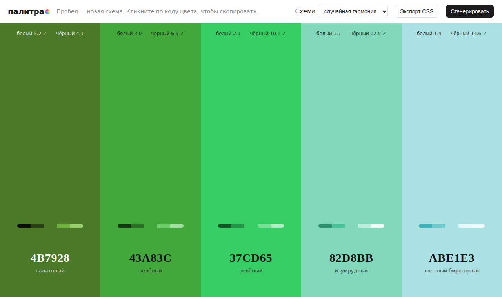

# Палитра: генератор цветовых схем

Генератор палитр из пяти цветов: нажимаете пробел и получаете согласованную схему. Цвета можно зафиксировать, переставить, скопировать и выгрузить в CSS.



## Возможности

- Режимы гармонии: аналоговая, монохромная, комплементарная, триада, пастель и случайный выбор из них
- Новая схема по пробелу или кнопке «Сгенерировать»
- Фиксация понравившихся цветов замком, они не меняются при генерации
- Перестановка колонок кнопками ← →, замок переезжает вместе с цветом
- Контраст по WCAG с белым и с чёрным текстом на каждой плашке, отметка ✓ при значении от 4,5
- Цвет подписи на плашке выбирается автоматически по лучшему контрасту
- Полоса оттенков: пять вариантов светлоты от каждого цвета
- Название цвета по-русски: «тёмный лазурный», «приглушённый изумрудный», «почти белый»
- Копирование HEX по клику на код
- Экспорт палитры в CSS-переменные `--color-1` … `--color-5` с копированием
- Палитра хранится в адресе страницы (`#rrggbb-...`), ссылкой можно поделиться

## Стек

HTML5, CSS3 (Flexbox), JavaScript без библиотек, Clipboard API, `<dialog>`, History API.

## Как запустить

Сборка не нужна: откройте `index.html` в браузере.

Или через локальный сервер:

```bash
python -m http.server 8000
# затем откройте http://localhost:8000
```

## Управление

| Действие | Как |
|---|---|
| Новая палитра | Пробел или кнопка «Сгенерировать» |
| Зафиксировать цвет | Кнопка с замком на плашке |
| Сдвинуть цвет | Кнопки ← → на плашке |
| Скопировать HEX | Клик по коду цвета |
| Экспорт CSS | Кнопка «Экспорт CSS» |

## Структура проекта

```
index.html      # разметка, стили, генерация палитр и конвертация цветов
screenshot.png  # скриншот для README
LICENSE         # лицензия MIT
```

## Как это устроено

- Цвета хранятся в HSL, генерация задаёт оттенок, насыщенность и светлоту по правилам выбранной гармонии (сдвиг оттенка на 22° для аналоговой, 180° для комплементарной, 120° для триады).
- Перевод HSL в HEX и обратно, относительная яркость и коэффициент контраста WCAG 2 написаны вручную, без библиотек цвета.
- Название цвета подбирается по ближайшему оттенку из таблицы, а приставка зависит от насыщенности и светлоты.
- Адрес обновляется через `history.replaceState`, поэтому история браузера не засоряется; при загрузке палитра восстанавливается из hash, если там ровно пять корректных HEX-кодов.
- Если Clipboard API недоступен, код цвета показывается во всплывающем сообщении.
- На ширине до 700px колонки становятся строками.

## Идеи для развития

- Сохранение фиксации цветов в ссылке
- Экспорт в Tailwind-конфиг и JSON
- Ручной ввод цвета для построения схемы от него

## Лицензия

MIT © 2026 whysafe. Telegram: [@yawhysafe](https://t.me/yawhysafe) · Сайт: [whysafe.ru](https://whysafe.ru)
